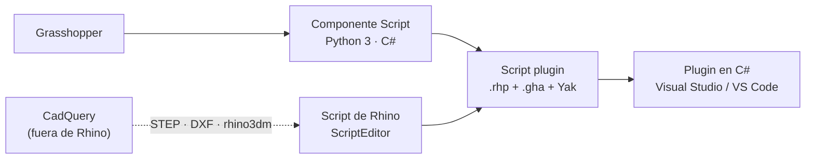

# Programación (Python, C#, RhinoCommon y plugins)

↑ [[Inicio]] · [[Mapa - Grasshopper]]

Todo lo que es código: Python (CadQuery y scripts de Rhino), C#, RhinoCommon (la API de Rhino), plugins, algoritmos y pruebas.

## Cómo se relaciona todo (empezar aquí)

1. [[wiki/concepts/ecosistema-programacion-rhino|Ecosistema de programación de Rhino]]: Grasshopper, componentes Script, scripts de Rhino, rhinoscriptsyntax, plugins, rhino3dm y CadQuery. Incluye la pila, cuándo usar cada uno y la **misma tarea escrita en siete lugares**.
2. [[wiki/concepts/python-csharp-rhinocommon|Traducir entre Python y C#]]: tabla de sintaxis, las cuatro diferencias que importan y un ejemplo lado a lado.
3. [[wiki/concepts/plugins-rhino-grasshopper|Del script al plugin]]: script plugins del Script Editor (sin C#) y plugins en C# (Visual Studio o VS Code).

## RhinoCommon por tema

La misma API sirve en Python, en C# y en Grasshopper. Cada namespace tiene su mapa, y cada mapa tiene **componentes de Grasshopper**, una tabla de **equivalencias** y las **muestras oficiales en Python y C#**:

| Para… | RhinoCommon | Mapa |
|---|---|---|
| Curvas, superficies, sólidos, mallas | `Rhino.Geometry` | [[Mapa - Curvas]] · [[Mapa - Superficies y NURBS]] · [[Mapa - Brep y sólidos]] · [[Mapa - Mallas y SubD]] |
| Puntos, vectores, planos, transformaciones | `Point3d`, `Vector3d`, `Plane`, `Transform` | [[Mapa - Puntos, vectores y planos]] · [[Mapa - Transformaciones]] |
| Intersecciones, proyecciones, booleanas | `Rhino.Geometry.Intersect` | [[Mapa - Intersecciones y booleanos]] |
| Deformar (twist, bend, flow) | `Rhino.Geometry.Morphs` | [[Mapa - Morph y tween]] |
| Capas, bloques, grupos, atributos, datos propios | `Rhino.DocObjects`, `doc.Layers`, `doc.InstanceDefinitions` | [[Mapa - Documento de Rhino]] |
| Pedir datos, opciones, archivos | `Rhino.Input.Custom`, `Rhino.FileIO` | [[Mapa - Scripts, interfaz y archivos]] |
| Vistas, dibujo en pantalla, cotas, textos | `Rhino.Display`, anotaciones | [[Mapa - Visualización y anotaciones]] · [[Mapa - CAD 2D y planos]] |
| Corte, desarrollo, contornos | `Unroller`, `Brep.Split`, `CreateContourCurves` | [[Mapa - Fabricación]] |

## Muestras y guías oficiales (McNeel)

- [[wiki/sources/2026-10-13-muestras-rhinocommon-python-csharp|158 muestras de RhinoCommon]], cada una en Python y C#. Están repartidas en los mapas de arriba; 29 existen solo en C# y son buen ejercicio de traducción.
- [[wiki/sources/2026-10-13-guias-scripting-rhino8|Scripting en Rhino 8]]: ScriptEditor, Python 3 frente a Python 2, componentes Script, `out` y sobrecargas.
- [[wiki/sources/2026-10-13-guias-plugins-rhino|Plugins y rhino3dm]]: qué es RhinoCommon, el primer plugin (Windows y Mac), script plugins.
- [[wiki/sources/2026-10-13-guias-data-trees|Data trees]]: por qué existen y cómo usarlos desde Python.
- Herramientas para traer más: `Wiki Rhino/herramientas/muestras_rhinocommon.py` (muestras) y `guias_mcneel.py` (guías).

## RhinoCommon (wiki)
- [[wiki/entities/rhinocommon]] · [[wiki/concepts/tipos-geometria-rhinocommon]]
- Documento: [[wiki/concepts/rhinocommon-document-api]] · [[wiki/concepts/rhinocommon-capas-api]] · [[wiki/concepts/rhinocommon-anotaciones-api]]
- Geometría: [[wiki/concepts/rhinocommon-mesh-api]] · [[wiki/concepts/rhinocommon-interseccion-api]]
- Interacción: [[wiki/concepts/interactive-object-selection]] · [[wiki/concepts/getobject-loop-pattern]] (pendiente)
- [[wiki/entities/rhinoscriptsyntax]]: el atajo de Python (y su equivalencia con RhinoCommon)
- [[wiki/entities/rhino3dm]]: archivos `.3dm` sin Rhino

## Grasshopper con código
- [[Mapa - Scripts, interfaz y archivos]] · [[wiki/concepts/data-trees]] (`DataTree`, `GH_Path`, List Access)
- [[Editar Grasshopper desde código]]: crear y conectar componentes por SDK, componente Python 3 por código, hornear sin perder estilo ni bloque
- Cada mapa de geometría tiene una tabla **Grasshopper ↔ RhinoCommon ↔ CadQuery**: [[Mapa - Grasshopper]]

## Aprender
- [[Aprendizaje/CadQuery/CadQuery vs RhinoCommon]]: la misma idea en dos APIs
- [[Aprendizaje/Algoritmos/OVERKILL (CADCraft)]]: agrupar primero, comparar después (de O(n²) a O(n log n))

## Proyectos

## Herramientas
[[Mapa - Entorno y herramientas]] (uv, Git, Cursor, Obsidian)
