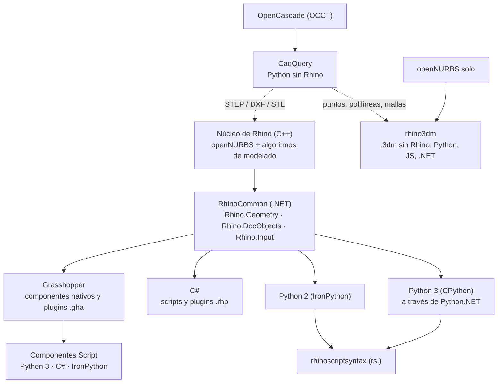

Todo lo que se programa **dentro** de Rhino pasa por **RhinoCommon**: los componentes de Grasshopper, los scripts de Python y de C#, `rhinoscriptsyntax` y los plugins usan la misma API y los mismos tipos (`Curve`, `Brep`, `Mesh`). Cambian tres cosas: **dónde corre** el código, **cómo recibe y entrega los datos**, y **cómo se comparte**. CadQuery es un mundo paralelo, con otro núcleo geométrico (OpenCascade), y se conecta con Rhino por archivos (STEP, DXF) o con rhino3dm. Esta página es el mapa para decidir qué usar y cómo pasar de una forma a otra.

## La pila



Dos ideas que se desprenden del diagrama:

- **rhinoscriptsyntax no es otra API**: son funciones de Python escritas sobre RhinoCommon ([[wiki/entities/rhinoscriptsyntax]]). `rs.DivideCurve` llama por dentro a `Curve.DivideByCount`.
- **rhino3dm solo trae openNURBS**: los tipos de geometría y el formato `.3dm`, sin los algoritmos de modelado de Rhino (booleanas, offsets, intersecciones). Para eso necesita Rhino o Rhino.Compute ([[wiki/entities/rhino3dm]]).

## Ocho formas de programar con Rhino

| Forma | Dónde corre | Cómo entran y salen los datos | Se comparte como | En mis proyectos |
|---|---|---|---|---|
| Definición de Grasshopper | Rhino + Grasshopper | cables con [[wiki/concepts/data-trees\|árboles]] | `.gh` | nesting con [[wiki/entities/opennest\|OpenNest]] |
| Componente Script | dentro de una definición | entradas (Item / List / Tree) → salidas | `.gh`, User Object | OVERKILL para Grasshopper (idea) |
| Script de Rhino (`ScriptEditor`) | Rhino | pide con `RhinoGet` / `GetObject` → `doc.Objects.Add…` | `.py` / `.cs`, botón o alias | OVERKILL v3 |
| rhinoscriptsyntax | dentro de un script Python | identificadores (Guid) de objetos | es una librería | primeros scripts |
| Script plugin (Rhino 8) | Rhino + Grasshopper | igual que el script o el componente original | `.rhp` + `.gha` + paquete Yak | toolkit sin Visual Studio |
| Plugin en C# | Rhino + Grasshopper | clases `Command` y `GH_Component` | `.rhp` / `.gha` + Yak | plugin de muebles CNC |
| rhino3dm | cualquier Python, sin Rhino | lee y escribe archivos `.3dm` | paquete de PyPI | puente desde `cad-python` |
| CadQuery | cualquier Python, sin Rhino | objetos de CadQuery → STEP / DXF / STL | script `.py` con uv | cad-python |

## La escalera: cuándo subir un peldaño

1. **Grasshopper puro** → pasar a un **componente Script** cuando la definición se llena de componentes para resolver un bucle o una condición, o cuando el componente que hace falta no existe.
2. **Componente Script** → **User Object** o script compartido cuando se copia entre definiciones; **script plugin** cuando lo van a usar otros o en otros equipos.
3. **Script de Rhino** cuando el trabajo es sobre el **documento** (capas, selección, bloques, planos) y no sobre una definición.
4. **Script plugin**: comandos y componentes instalables desde el Package Manager (Windows y Mac) **sin escribir C#**. Al publicarlo genera además la solución de Visual Studio ([[wiki/concepts/plugins-rhino-grasshopper]]).
5. **Plugin en C#** cuando hace falta interfaz propia (Eto), paneles, eventos del documento, dibujo persistente (*display conduits*), rendimiento o pruebas automáticas.

**El principio que une todo**: el paso "calcular" es el mismo en cada peldaño (`curve.Offset(...)` se escribe igual en un componente, un script o un plugin). Conviene separar un **núcleo** (funciones que reciben geometría y devuelven geometría) de una **cáscara** (de dónde salen los datos y adónde van). OVERKILL ya lo hace: su núcleo está probado con pytest. El toolkit en C# propuesto en Plugins Rhino y Grasshopper sigue la misma idea, con `Core` y `GH`.

## Piedra de Rosetta: la misma tarea en siete lugares

Tarea: dividir una curva en 10 partes iguales y obtener los puntos.

**Grasshopper**: [[Catálogo - Curve#Divide Curve (Divide)|Divide Curve]] (entrada C = curva, N = 10; salida P = puntos).

**rhinoscriptsyntax**:
```python
import rhinoscriptsyntax as rs
crv_id = rs.GetObject("Curva", rs.filter.curve)
rs.AddPoints(rs.DivideCurve(crv_id, 10))
```

**RhinoCommon en Python** (script de Rhino):
```python
import Rhino
import scriptcontext as sc
rc, ref = Rhino.Input.RhinoGet.GetOneObject("Curva", False, Rhino.DocObjects.ObjectType.Curve)
crv = ref.Curve()
for t in crv.DivideByCount(10, True):          # parámetros t de los puntos
    sc.doc.Objects.AddPoint(crv.PointAt(t))
sc.doc.Views.Redraw()
```

**RhinoCommon en C#** (script de Rhino):
```csharp
using Rhino;
using Rhino.Input;
using Rhino.DocObjects;
var rc = RhinoGet.GetOneObject("Curva", false, ObjectType.Curve, out ObjRef objRef);
var crv = objRef.Curve();
foreach (double t in crv.DivideByCount(10, true))
    RhinoDoc.ActiveDoc.Objects.AddPoint(crv.PointAt(t));
RhinoDoc.ActiveDoc.Views.Redraw();
```

**Componente Script de Grasshopper, Python 3** (entrada `crv` con hint *Curve*, `n` con hint *int*):
```python
a = [crv.PointAt(t) for t in crv.DivideByCount(n, True)]
```

**Componente Script de Grasshopper, C#** (mismas entradas):
```csharp
using System.Collections.Generic;
using Rhino.Geometry;
var pts = new List<Point3d>();
foreach (double t in crv.DivideByCount(n, true))
    pts.Add(crv.PointAt(t));
a = pts;
```

**CadQuery** (sin Rhino):
```python
import cadquery as cq
edge = cq.Workplane().spline([(0, 0), (10, 5), (20, 0)]).val()   # una Edge
pts = [edge.positionAt(i / 10) for i in range(11)]               # 0..1 por largo de arco
```

Lo que hay que notar: en los cuatro casos de RhinoCommon la línea que calcula es **la misma** (`DivideByCount` + `PointAt`). Lo que cambia es la cáscara. En Grasshopper no hay `GetOneObject` ni `AddPoint`: la curva entra por un cable y los puntos salen por otro. CadQuery usa otra API, pero la idea es la misma: parámetro a lo largo de la curva → punto.

Hay 158 ejemplos más de este tipo, con Python y C# lado a lado, en las tablas **Muestras de RhinoCommon** de cada mapa ([[wiki/sources/2026-10-13-muestras-rhinocommon-python-csharp]]). La traducción entre los dos lenguajes está en [[wiki/concepts/python-csharp-rhinocommon]].

## CadQuery ↔ Rhino

Los dos trabajan con **B-rep**: sólidos descritos por caras, aristas y vértices ([[wiki/concepts/brep-polisuperficies]]). Los nombres cambian:

| CadQuery (OpenCascade) | RhinoCommon |
|---|---|
| `cq.Vector` | `Point3d` / `Vector3d` |
| `cq.Plane`, `Workplane` | `Plane` |
| `Vertex` | `BrepVertex` (o un `Point`) |
| `Edge` | `Curve` (dentro de un Brep: `BrepEdge`) |
| `Wire` | curva unida (`PolyCurve`); el contorno de una cara es un `BrepLoop` |
| `Face` | `BrepFace` (superficie recortada) |
| `Shell` | `Brep` abierto (polisuperficie) |
| `Solid` | `Brep` cerrado (`brep.IsSolid`) |
| `Compound` | lista de Brep, o un grupo |
| `Assembly` | bloques (`InstanceDefinition`) |

Cómo pasar geometría de uno al otro:

| Camino | Cómo | Para qué |
|---|---|---|
| **STEP** | `cq.exporters.export(pieza, "pieza.step")` → en Rhino, *Import* | sólidos exactos: el camino normal |
| **DXF** | `cq.exporters.export(perfil, "corte.dxf")` → Rhino o CADCraft | perfiles 2D para CNC ([[Mapa - CAD 2D y planos]]) |
| **STL** | `cq.exporters.export(pieza, "pieza.stl")` | impresión 3D (malla) |
| **rhino3dm** | escribir un `.3dm` desde Python con capas, nombres y atributos | puntos, polilíneas y mallas organizados por capa |

Convertir sólidos NURBS de OpenCascade a rhino3dm a mano no es trivial; para sólidos, STEP es lo confiable. Diferencias prácticas, ya anotadas en [[Aprendizaje/CadQuery/CadQuery vs RhinoCommon]]: CadQuery selecciona caras con texto (`">Z"`) y Rhino por índice o con el mouse. CadQuery no tiene SubD ni Kangaroo. En los dos, un patrón plano conviene resolverlo en 2D y extruirlo al final.

## Equivalencias por tema

Cada mapa temático tiene dos herramientas para "traducir":

- una tabla **Grasshopper ↔ RhinoCommon ↔ CadQuery** (manual, en la sección *Equivalencias*);
- la tabla **Muestras de RhinoCommon** (automática) con el ejemplo oficial en Python y en C#.

Empezar por [[Mapa - Curvas]] (la tabla más completa), [[Mapa - Brep y sólidos]] y [[Mapa - Fabricación]].

## Conexiones

- Mapas: [[Mapa - Programación]] · [[Mapa - Grasshopper]] · [[Mapa - Scripts, interfaz y archivos]]
- [[wiki/concepts/python-csharp-rhinocommon]]: traducir entre Python y C#
- [[wiki/concepts/plugins-rhino-grasshopper]]: de script a plugin
- [[wiki/concepts/data-trees]]: cómo llegan los datos a un componente
- [[wiki/concepts/tipos-geometria-rhinocommon]]: los tipos que comparten todas las formas
- [[wiki/entities/rhinocommon]] · [[wiki/entities/rhinoscriptsyntax]] · [[wiki/entities/grasshopper]] · [[wiki/entities/rhino3dm]]
- [[Aprendizaje/CadQuery/CadQuery vs RhinoCommon]] · cad-python · overkill-rhino

## Fuentes

- Pila, Python 3/2 y rhinoscriptsyntax: [[wiki/sources/2026-10-13-guias-scripting-rhino8]].
- RhinoCommon, script plugins y rhino3dm: [[wiki/sources/2026-10-13-guias-plugins-rhino]].
- Muestras en dos lenguajes: [[wiki/sources/2026-10-13-muestras-rhinocommon-python-csharp]].
- La tabla CadQuery ↔ RhinoCommon, los caminos de exportación y la "escalera" son **síntesis propia** (conocimiento general de CadQuery/OpenCascade y de mis proyectos). Los fragmentos de código siguen la API documentada, pero **no se han probado** en Rhino. Si alguno falla, anotarlo aquí.
